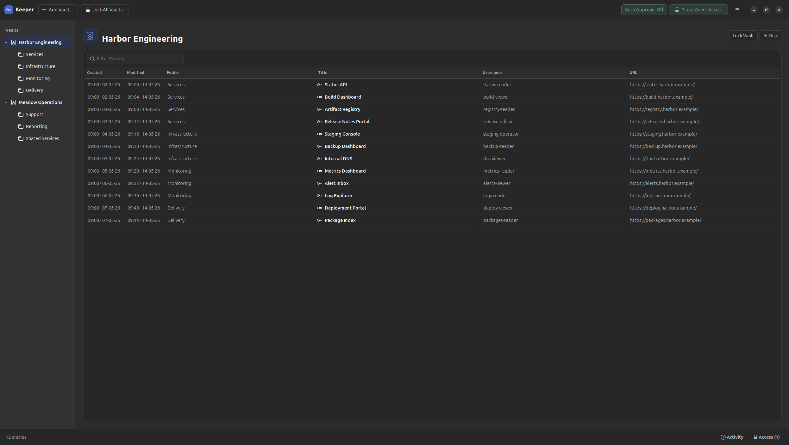
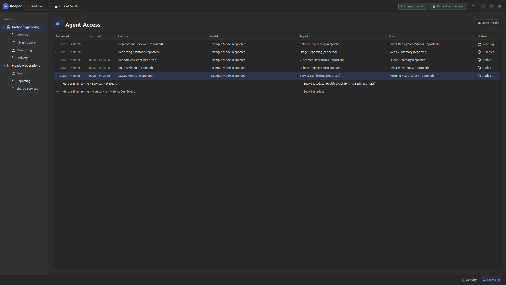
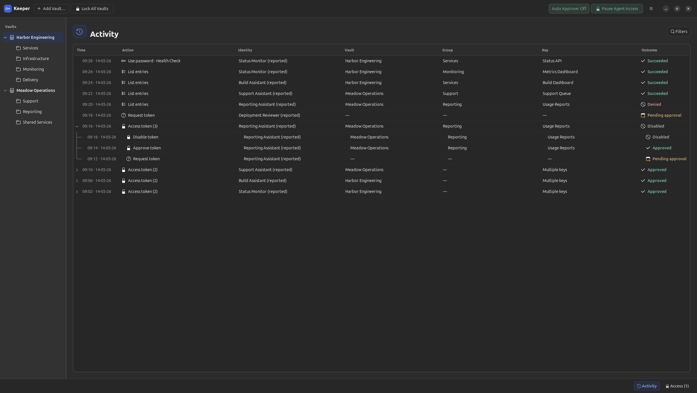

# Keeper

Keeper is a Linux desktop and tray app for managing KeePass vaults and giving agents scoped access. You decide which entries an agent can use and what it can do with them.

## Quick Start

On Ubuntu GNOME, clone this repository and run one of these commands from the checkout.

| Setup | Command |
| --- | --- |
| Desktop app and tray icon | `./install` |
| Desktop app and local agent connection | `./install --connect-agent` |

1. Open **Keeper** and select **Add Vault…** to open an existing KeePass database.
2. To remember a vault password, select **Remember on This Device**. Keeper stores it in the OS keyring.
3. For agent access, open **Settings → Connect an Agent**. Add the MCP command to your agent client and give the agent the installed [Keeper skill](skills/keepassxc-agent-access/SKILL.md). Open **Access** to review requests for entries and permissions.

## Agent Access

**Security boundary.** Keep every agent tool outside your desktop owner account and session. The bundled runner isolates the Keeper connection. Agents with owner-session shell or desktop privileges can act with the owner’s authority. Use a tools-only agent or isolate its remaining capabilities and escalation paths. See [agent isolation](docs/guide.md#isolate-the-agent-runtime).

Agents can discover vault, group, and entry names before requesting access. Discovery shows names and references, and respects **Pause Agent Access**. Approve an entry's required use permissions and network destinations; the agent can then supply commands, HTTPS requests, and browser forms directly, without preconfigured actions.

Expand a token to see which vaults, groups, and entries it covers. Open its details to review requested permissions, or disable or remove a token you previously approved. Use **Pause Agent Access** to stop agents from using their tokens.

## Activity

See which agent acted, which resource it used, and what happened. Expand related events for their history or double-click an event for details and its audit note. Approved credential use can authenticate HTTPS requests and browser forms, or deliver a secret to an isolated command through stdin or a credential prompt. Keeper records each use without returning credential values. Protected API workflows return selected inventory or other JSON fields while login tickets stay private, so agents can use the results to continue their tasks. Dynamic commands that receive a credential return a dispatch receipt while their output and exit status stay private. See [credential delivery](docs/guide.md#use-approved-credentials-without-preconfigured-actions).

The screenshots use disposable vaults and synthetic agent activity.

## Updates and Help

- **Update** from **Keeper Settings → Updates** using **Check for Updates**, then **Apply Update**.
- **Uninstall** with `./uninstall`. Your vault files and settings are kept.
- See the [User Guide](docs/guide.md) for vault management, approval settings, runner setup, and synthetic testing.
